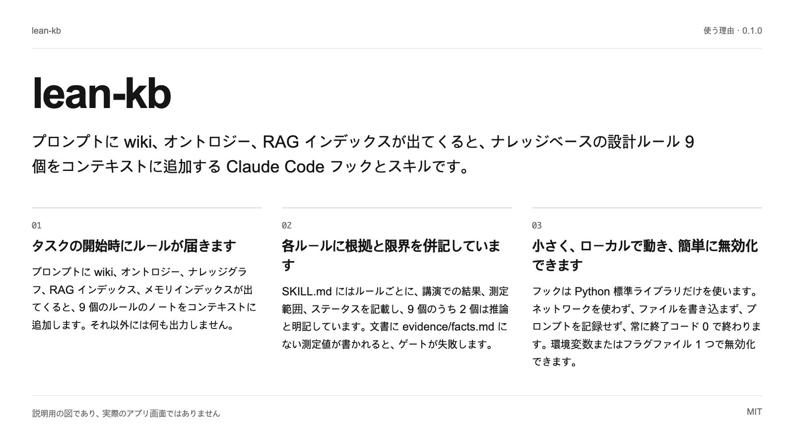
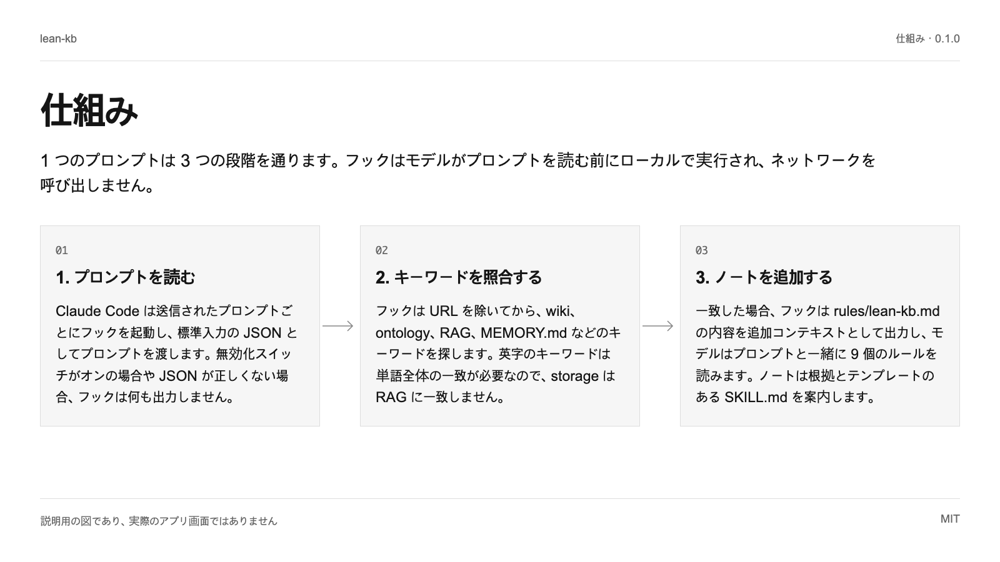
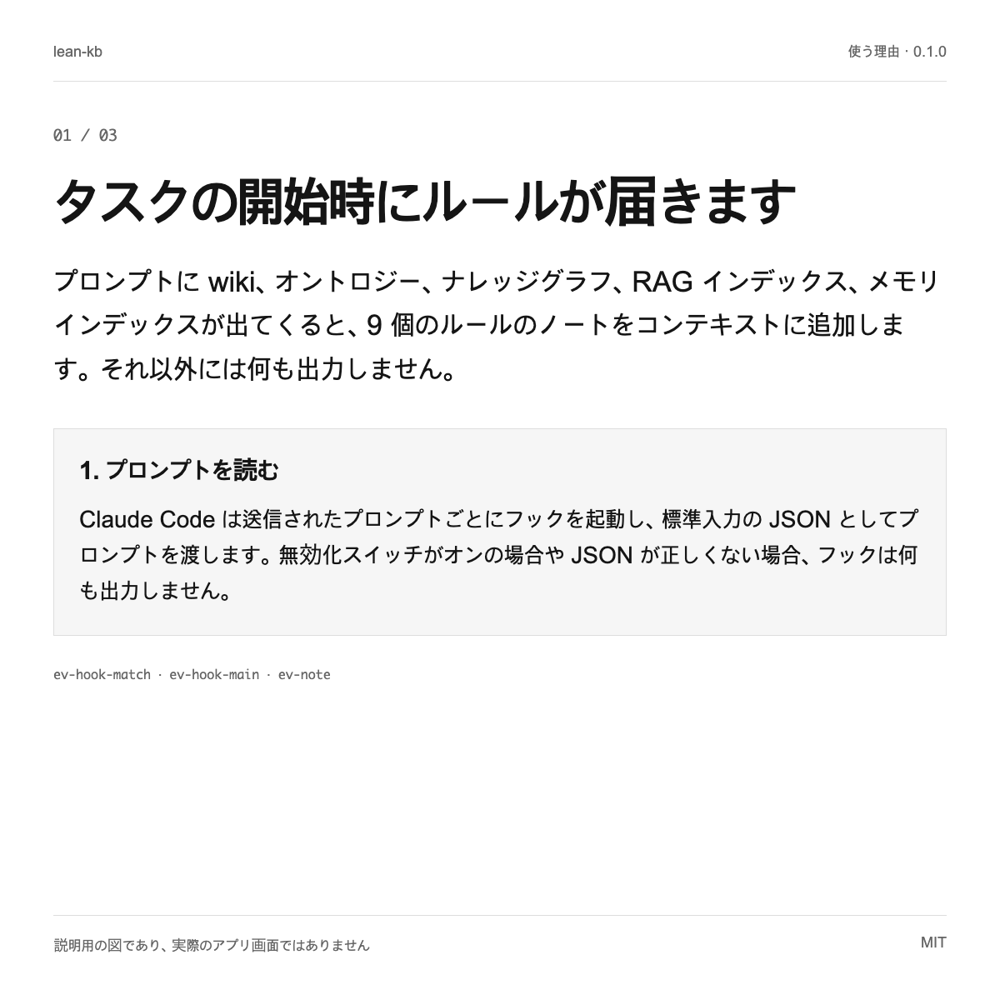
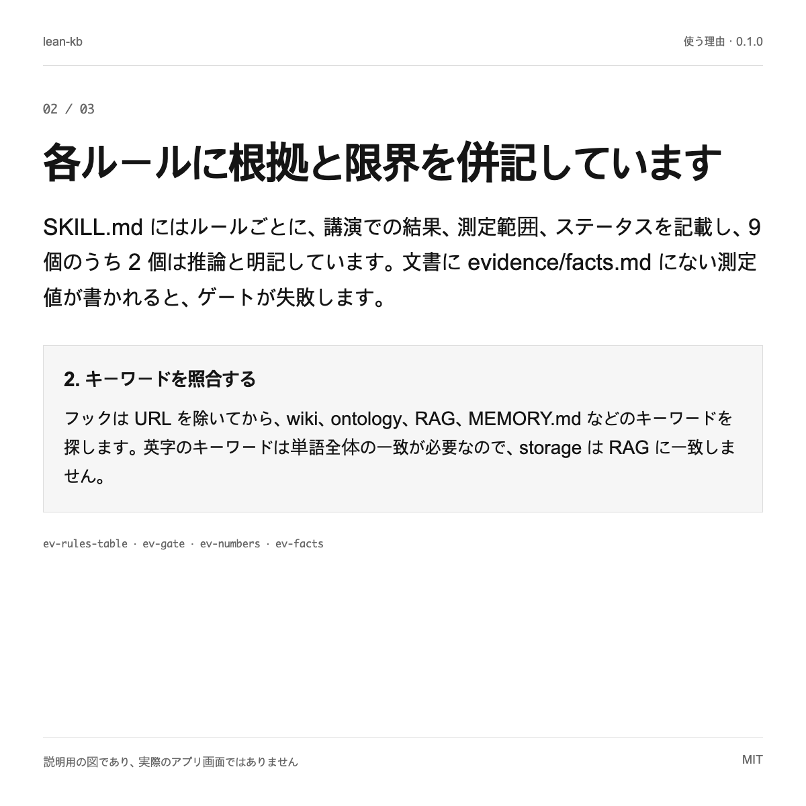
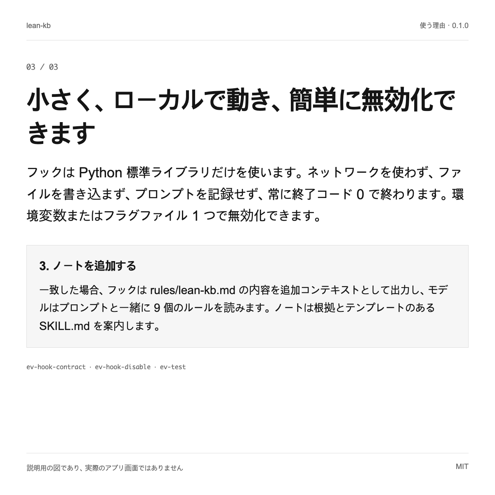

# lean-kb

プロンプトに wiki、オントロジー、RAG インデックスが出てくると、ナレッジベースの設計ルール 9 個をコンテキストに追加する Claude Code フックとスキルです。

[English](README.md) | [한국어](README.ko.md) | **日本語** | [简体中文](README.zh.md)



0.1.0 · MIT

## 使う理由

| | |
| --- | --- |
| タスクの開始時にルールが届きます | プロンプトに wiki、オントロジー、ナレッジグラフ、RAG インデックス、メモリインデックスが出てくると、9 個のルールのノートをコンテキストに追加します。それ以外には何も出力しません。 |
| 各ルールに根拠と限界を併記しています | SKILL.md にはルールごとに、講演での結果、測定範囲、ステータスを記載し、9 個のうち 2 個は推論と明記しています。文書に evidence/facts.md にない測定値が書かれると、ゲートが失敗します。 |
| 小さく、ローカルで動き、簡単に無効化できます | フックは Python 標準ライブラリだけを使います。ネットワークを使わず、ファイルを書き込まず、プロンプトを記録せず、常に終了コード 0 で終わります。環境変数またはフラグファイル 1 つで無効化できます。 |

## クイックスタート

Claude Code、Python 3、bash、git が必要です。次の 3 行をターミナルに入力します。順に、スキルを取得し、フックのセルフテストを実行し、サンプルのプロンプトを 1 つフックに送ります。

```text
git clone https://github.com/grow1023/lean-kb.git ~/.claude/skills/lean-kb
bash ~/.claude/skills/lean-kb/hooks/lean_kb_hook.test.sh
printf '%s' '{"prompt":"design a wiki index"}' | python3 ~/.claude/skills/lean-kb/hooks/lean_kb_hook.py
```

セルフテストはケースごとに PASS を 1 行出力し、最後に ALL PASS を出力します。3 行目は、additionalContext が [lean-kb] で始まる JSON オブジェクトを出力します。フックを有効にするには、~/.claude/settings.json の hooks.UserPromptSubmit リストに次のオブジェクトを追加し、新しいセッションを開始します: `{"hooks":[{"type":"command","command":"python3 -I \"$HOME/.claude/skills/lean-kb/hooks/lean_kb_hook.py\"","timeout":5}]}`

## 仕組み

1 つのプロンプトは 3 つの段階を通ります。フックはモデルがプロンプトを読む前にローカルで実行され、ネットワークを呼び出しません。



### 1. プロンプトを読む

Claude Code は送信されたプロンプトごとにフックを起動し、標準入力の JSON としてプロンプトを渡します。無効化スイッチがオンの場合や JSON が正しくない場合、フックは何も出力しません。

### 2. キーワードを照合する

フックは URL を除いてから、wiki、ontology、RAG、MEMORY.md などのキーワードを探します。英字のキーワードは単語全体の一致が必要なので、storage は RAG に一致しません。

### 3. ノートを追加する

一致した場合、フックは rules/lean-kb.md の内容を追加コンテキストとして出力し、モデルはプロンプトと一緒に 9 個のルールを読みます。ノートは根拠とテンプレートのある SKILL.md を案内します。

## 活用例

### チーム wiki のインデックスを設計する

wiki の構成を依頼すると、ノートがモデルに次のことを伝えます。ページ本文はページごとに 1 行のインデックスの後ろに置くこと、ルールは常に読み込まれる部分に置くこと、常に読み込まれる分量を明示すること。

### Claude Code のメモリインデックスを整理する

MEMORY.md の整理を依頼すると、ルールに従って、ルールの行は切り捨て上限より上に置き、事実の本文はインデックス行の後ろに移します。SKILL.md には、1 つのセッションがインデックスをどれだけ開くかを手作業で測る方法があります。

### チェックを先に決めてオントロジーのスキーマを変更する

オントロジーやナレッジグラフの変更を依頼すると、ノートは、エンティティごとに 1 つの正規ノード、変更された事実には日付付きの項目、そして結果を見る前に定義したチェックを求めます。正規ノードのルールは SKILL.md で推論と明記されています。







## 制約とプライバシー

- ルールの根拠は 1 本の講演（NAVER D2、https://d2.naver.com/helloworld/5087915）で、サンプルは小さく、1 つの環境から得られた値です。講演では wiki やオントロジーでこれらのルールを検証していません。頼る前に、ご自身のリポジトリで各ルールを確認してください。

- このプロジェクトは独立した要約です。NAVER のプロジェクトではなく、講演に登場する Haema エンジンでもありません。検索、重複排除、セッションロールオーバーは実装していません。

- フックはキーワードだけを照合します。キーワードを含まないナレッジベースの依頼にはノートが追加されず、そのような依頼の割合は測定していません。Obsidian、memory、CLAUDE.md、graph は、無関係なプロンプトに一致することのほうが多かったため、キーワードに含めていません。

- フックは状態を保持しません。一致したプロンプトごとにノート全体を追加するため、コストはノートのサイズに、セッション内で一致したプロンプトの数を掛けた値になります。

- フックはユーザーが送信したプロンプトに対して実行されます。サブエージェントは親エージェントからプロンプトを受け取るため、ノートは届かないと考えられます。この動作はテストしていません。ナレッジベース作業を委任する場合は、rules/lean-kb.md のパスをサブエージェントに渡してください。

- セルフテストとゲートは macOS の bash と Python 3 で実行しました。Linux と Windows ではテストしていません。ゲートの文体チェックには、別プロジェクトである asd-ste100 のリンターが必要です。リンターがない場合、LEAN_KB_SKIP_STE=1 を設定しない限り、そのチェックは失敗します。

## 検証状況

- **実行確認済み**: フックのセルフテストを実行し、すべてのケースが通りました。ノートが追加されるべきプロンプト、何も出力されないべきプロンプト、2 種類の無効化スイッチ、ルールファイルがない場合、プロンプトの本文が出力に現れないことの確認を含みます。
- **実行確認済み**: マスターゲートは終了コード 0 で完了しました。ゲートは Python ファイルをコンパイルし、セルフテストを実行し、ルールノートのサイズを確認し、文体リンターを実行し、SKILL.md と README に書かれた測定値を evidence/facts.md と照合します。
- **実行確認済み**: 一時的な設定ファイルを使った 1 回の Claude Code セッションで、wiki のプロンプトにはノートが届き、無関係なプロンプトには届きませんでした。これは 1 台のマシンでの 1 回の実行結果です。
- **文書に記載**: SKILL.md の数値は、講演の要約ファイルから転記したものです。スライドから読み取った値と、音声のみで確認した値を区別して表示しています。音声のみの値は機械による文字起こしに基づくため、誤りを含む可能性があります。

## 次のステップ

根拠の表、テンプレート、最初に測るべき 3 つの比率は SKILL.md にあります。フックを無効にするには、LEAN_KB_DISABLE=1 を設定するか、~/.claude/lean-kb.off というファイルを作成します。削除するには、settings.json から該当の項目を消してから、フォルダーを削除します。

<details>
<summary>根拠一覧</summary>

[JSON](docs/showcase/sources.json)

- `ev-hook-contract`: `hooks/lean_kb_hook.py`, L3–L17 (コード確認済み)
- `ev-hook-match`: `hooks/lean_kb_hook.py`, L23–L59 (コード確認済み)
- `ev-hook-disable`: `hooks/lean_kb_hook.py`, L62–L66 (コード確認済み)
- `ev-hook-main`: `hooks/lean_kb_hook.py`, L76–L93 (コード確認済み)
- `ev-note`: `rules/lean-kb.md`, L1–L13 (文書に記載)
- `ev-rules-table`: `SKILL.md`, L18–L34 (文書に記載)
- `ev-measure`: `SKILL.md`, L36–L46 (文書に記載)
- `ev-templates`: `SKILL.md`, L48–L91 (文書に記載)
- `ev-register`: `SKILL.md`, L93–L101 (文書に記載)
- `ev-hook-behavior`: `SKILL.md`, L103–L111 (文書に記載)
- `ev-live-check`: `SKILL.md`, L112–L112 (実行確認済み)
- `ev-subagent`: `SKILL.md`, L114–L116 (文書に記載)
- `ev-limits`: `SKILL.md`, L118–L126 (文書に記載)
- `ev-test`: `hooks/lean_kb_hook.test.sh`, L1–L74 (実行確認済み)
- `ev-gate`: `gates/verify_lean_kb.sh`, L1–L67 (実行確認済み)
- `ev-numbers`: `scripts/check_numbers.py`, L2–L10 (実行確認済み)
- `ev-facts`: `evidence/facts.md`, L1–L5 (文書に記載)

- `rules-at-task-time` → `ev-hook-match`, `ev-hook-main`, `ev-note`
- `evidence-with-limits` → `ev-rules-table`, `ev-gate`, `ev-numbers`, `ev-facts`
- `small-and-reversible` → `ev-hook-contract`, `ev-hook-disable`, `ev-test`
- `read-prompt` → `ev-hook-contract`, `ev-hook-disable`, `ev-hook-main`
- `match-keywords` → `ev-hook-match`, `ev-test`
- `add-note` → `ev-hook-main`, `ev-note`, `ev-rules-table`
- `team-wiki` → `ev-note`, `ev-templates`
- `memory-index` → `ev-note`, `ev-measure`, `ev-limits`
- `schema-change` → `ev-note`, `ev-rules-table`, `ev-templates`
- `one-talk` → `ev-limits`, `ev-facts`
- `not-affiliated` → `ev-limits`, `ev-facts`
- `keyword-trigger` → `ev-hook-behavior`
- `stateless-cost` → `ev-hook-behavior`, `ev-hook-contract`
- `subagents` → `ev-subagent`
- `platform` → `ev-gate`, `ev-limits`
- `v-selftest` → `ev-test`
- `v-gate` → `ev-gate`, `ev-numbers`
- `v-live` → `ev-live-check`
- `v-talk-numbers` → `ev-facts`, `ev-rules-table`
- `quickstart` → `ev-register`, `ev-test`, `ev-hook-main`

</details>
