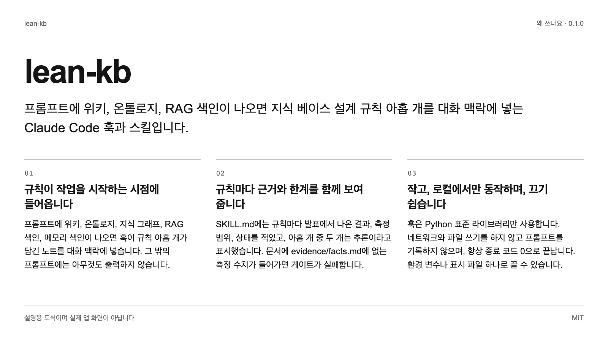
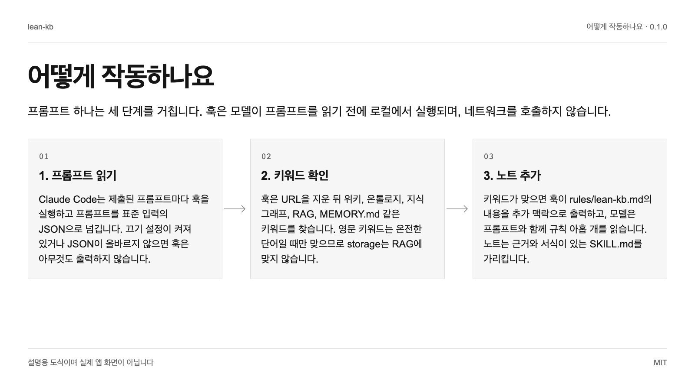
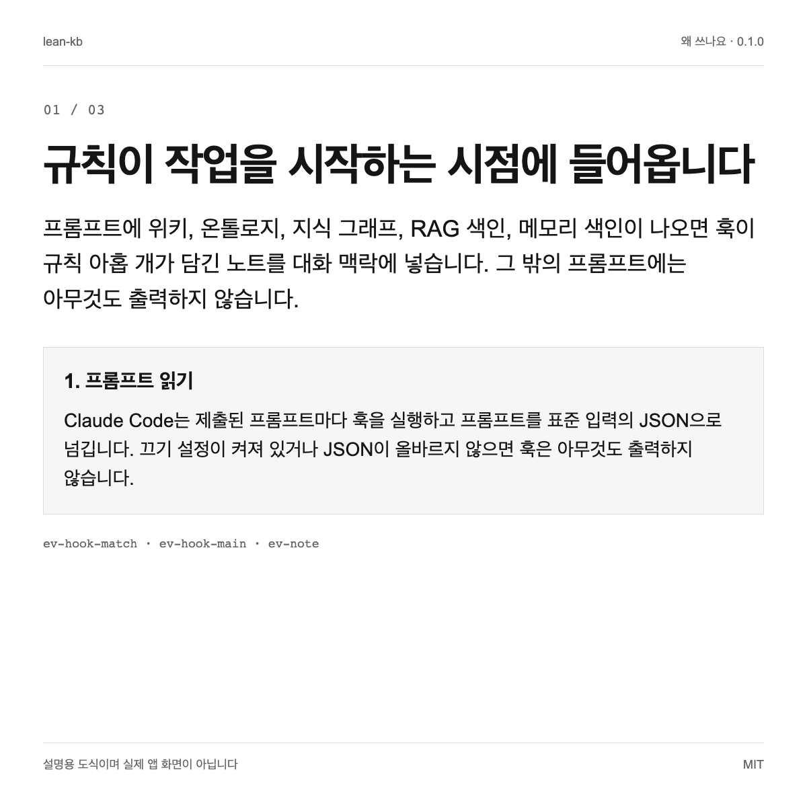
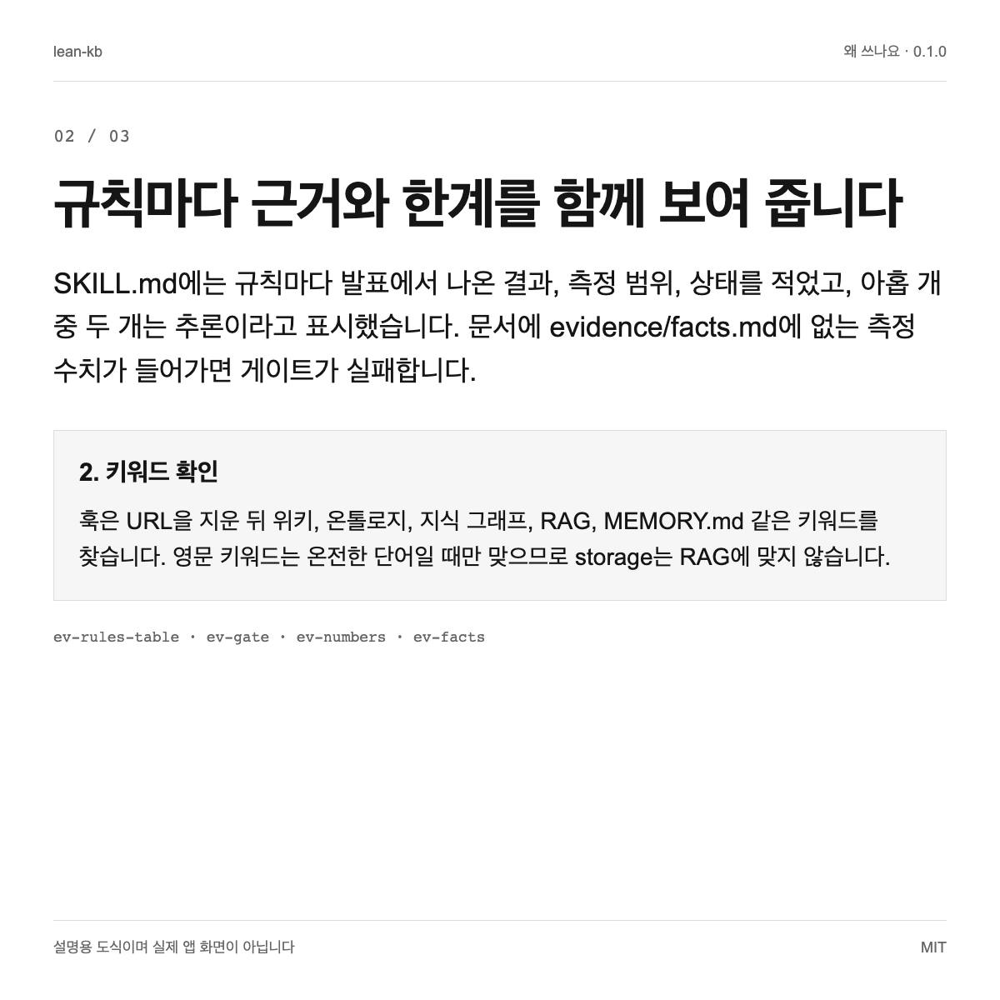
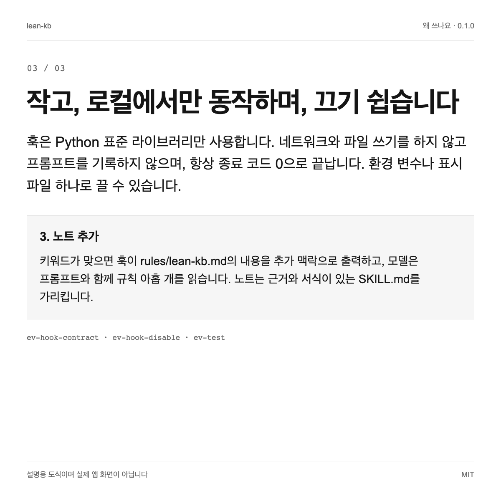

# lean-kb

프롬프트에 위키, 온톨로지, RAG 색인이 나오면 지식 베이스 설계 규칙 아홉 개를 대화 맥락에 넣는 Claude Code 훅과 스킬입니다.

[English](README.md) | **한국어** | [日本語](README.ja.md) | [简体中文](README.zh.md)



0.1.0 · MIT

## 왜 쓰나요

| | |
| --- | --- |
| 규칙이 작업을 시작하는 시점에 들어옵니다 | 프롬프트에 위키, 온톨로지, 지식 그래프, RAG 색인, 메모리 색인이 나오면 훅이 규칙 아홉 개가 담긴 노트를 대화 맥락에 넣습니다. 그 밖의 프롬프트에는 아무것도 출력하지 않습니다. |
| 규칙마다 근거와 한계를 함께 보여 줍니다 | SKILL.md에는 규칙마다 발표에서 나온 결과, 측정 범위, 상태를 적었고, 아홉 개 중 두 개는 추론이라고 표시했습니다. 문서에 evidence/facts.md에 없는 측정 수치가 들어가면 게이트가 실패합니다. |
| 작고, 로컬에서만 동작하며, 끄기 쉽습니다 | 훅은 Python 표준 라이브러리만 사용합니다. 네트워크와 파일 쓰기를 하지 않고 프롬프트를 기록하지 않으며, 항상 종료 코드 0으로 끝납니다. 환경 변수나 표시 파일 하나로 끌 수 있습니다. |

## 빠른 시작

Claude Code, Python 3, bash, git이 필요합니다. 아래 세 줄을 터미널에 입력합니다. 차례로 스킬을 내려받고, 훅 자체 시험을 실행하고, 예시 프롬프트 하나를 훅에 보냅니다.

```text
git clone https://github.com/grow1023/lean-kb.git ~/.claude/skills/lean-kb
bash ~/.claude/skills/lean-kb/hooks/lean_kb_hook.test.sh
printf '%s' '{"prompt":"design a wiki index"}' | python3 ~/.claude/skills/lean-kb/hooks/lean_kb_hook.py
```

자체 시험은 경우마다 PASS 한 줄을 출력하고 마지막에 ALL PASS를 출력합니다. 세 번째 줄은 additionalContext가 [lean-kb]로 시작하는 JSON 객체를 출력합니다. 훅을 켜려면 ~/.claude/settings.json의 hooks.UserPromptSubmit 목록에 다음 객체를 추가하고 새 세션을 시작합니다: `{"hooks":[{"type":"command","command":"python3 -I \"$HOME/.claude/skills/lean-kb/hooks/lean_kb_hook.py\"","timeout":5}]}`

## 어떻게 작동하나요

프롬프트 하나는 세 단계를 거칩니다. 훅은 모델이 프롬프트를 읽기 전에 로컬에서 실행되며, 네트워크를 호출하지 않습니다.



### 1. 프롬프트 읽기

Claude Code는 제출된 프롬프트마다 훅을 실행하고 프롬프트를 표준 입력의 JSON으로 넘깁니다. 끄기 설정이 켜져 있거나 JSON이 올바르지 않으면 훅은 아무것도 출력하지 않습니다.

### 2. 키워드 확인

훅은 URL을 지운 뒤 위키, 온톨로지, 지식 그래프, RAG, MEMORY.md 같은 키워드를 찾습니다. 영문 키워드는 온전한 단어일 때만 맞으므로 storage는 RAG에 맞지 않습니다.

### 3. 노트 추가

키워드가 맞으면 훅이 rules/lean-kb.md의 내용을 추가 맥락으로 출력하고, 모델은 프롬프트와 함께 규칙 아홉 개를 읽습니다. 노트는 근거와 서식이 있는 SKILL.md를 가리킵니다.

## 사용 예시

### 팀 위키의 색인 설계

위키 구조를 요청하면, 노트가 모델에게 페이지 본문은 페이지마다 색인 한 줄 뒤에 두고, 규칙은 늘 싣는 부분에 두며, 늘 싣는 분량을 밝히라고 알려 줍니다.

### Claude Code 메모리 색인 정리

MEMORY.md 정리를 요청하면, 규칙에 따라 규칙 줄은 잘리는 한도 위쪽에 두고 사실 본문은 색인 줄 뒤로 옮깁니다. SKILL.md에는 한 세션이 색인을 얼마나 여는지 손으로 재는 방법이 있습니다.

### 검사 기준을 먼저 정하고 온톨로지 스키마 변경

온톨로지나 지식 그래프 변경을 요청하면, 노트가 개체마다 대표 노드 하나, 바뀐 사실에는 날짜를 붙인 항목, 그리고 결과를 보기 전에 정한 검사를 요구합니다. 대표 노드 규칙은 SKILL.md에 추론으로 표시되어 있습니다.







## 한계와 개인정보

- 규칙의 근거는 발표 한 편(NAVER D2, https://d2.naver.com/helloworld/5087915)이고, 표본이 작으며 한 환경에서 나온 값입니다. 발표는 위키나 온톨로지에서 이 규칙들을 시험하지 않았습니다. 규칙에 의존하기 전에 대상 저장소에서 직접 확인해야 합니다.

- 이 프로젝트는 독립적으로 정리한 요약입니다. NAVER의 프로젝트가 아니며, 발표에 나온 Haema 엔진도 아닙니다. 검색, 중복 제거, 세션 롤오버는 구현하지 않습니다.

- 훅은 키워드만 확인합니다. 키워드가 없는 지식 베이스 요청에는 노트가 들어가지 않으며, 그런 요청의 비율은 측정하지 않았습니다. 옵시디언, 메모리, CLAUDE.md, 그래프는 무관한 프롬프트에 더 자주 맞아서 키워드에 넣지 않았습니다.

- 훅은 상태를 저장하지 않습니다. 키워드가 맞는 프롬프트마다 노트 전체를 넣으므로, 비용은 노트 크기에 한 세션에서 키워드가 맞은 프롬프트 수를 곱한 값입니다.

- 훅은 사용자가 제출한 프롬프트에서 실행됩니다. 서브에이전트는 상위 에이전트에게서 프롬프트를 받으므로 노트가 전달되지 않을 것으로 봅니다. 이 동작은 시험하지 않았습니다. 지식 베이스 작업을 위임할 때는 rules/lean-kb.md의 경로를 서브에이전트에 직접 알려 주십시오.

- 자체 시험과 게이트는 macOS의 bash와 Python 3에서 실행했습니다. Linux와 Windows에서는 시험하지 않았습니다. 게이트의 문체 검사에는 별도 프로젝트인 asd-ste100 린터가 필요합니다. 린터가 없으면 LEAN_KB_SKIP_STE=1을 설정하지 않는 한 그 검사가 실패합니다.

## 검증 상태

- **실행 확인**: 훅 자체 시험을 실행했고 모든 경우가 통과했습니다. 노트가 들어가야 하는 프롬프트, 아무것도 나오지 않아야 하는 프롬프트, 두 가지 끄기 설정, 규칙 파일이 없는 경우, 프롬프트 내용이 출력에 나타나지 않는지 확인하는 경우를 포함합니다.
- **실행 확인**: 마스터 게이트가 종료 코드 0으로 끝났습니다. 게이트는 Python 파일을 컴파일하고, 자체 시험을 실행하고, 규칙 노트의 크기를 확인하고, 문체 린터를 실행하며, SKILL.md와 README에 적힌 측정 수치를 evidence/facts.md와 대조합니다.
- **실행 확인**: 임시 설정 파일을 쓴 Claude Code 세션 한 번에서, 위키 프롬프트에는 노트가 전달되었고 무관한 프롬프트에는 전달되지 않았습니다. 한 대의 기기에서 한 번 실행한 결과입니다.
- **문서 기준**: SKILL.md의 수치는 발표를 요약한 파일에서 옮긴 값입니다. 슬라이드에서 읽은 값과 음성으로만 확인한 값을 구분해 표시했습니다. 음성으로만 확인한 값은 기계 전사에서 나온 것이어서 오류가 있을 수 있습니다.

## 다음 단계

근거 표, 서식, 먼저 재 볼 세 가지 비율은 SKILL.md에 있습니다. 훅을 끄려면 LEAN_KB_DISABLE=1을 설정하거나 ~/.claude/lean-kb.off 파일을 만듭니다. 제거하려면 settings.json에서 해당 항목을 지운 뒤 폴더를 삭제합니다.

<details>
<summary>근거 목록</summary>

[JSON](docs/showcase/sources.json)

- `ev-hook-contract`: `hooks/lean_kb_hook.py`, L3–L17 (코드 확인)
- `ev-hook-match`: `hooks/lean_kb_hook.py`, L23–L59 (코드 확인)
- `ev-hook-disable`: `hooks/lean_kb_hook.py`, L62–L66 (코드 확인)
- `ev-hook-main`: `hooks/lean_kb_hook.py`, L76–L93 (코드 확인)
- `ev-note`: `rules/lean-kb.md`, L1–L13 (문서 기준)
- `ev-rules-table`: `SKILL.md`, L18–L34 (문서 기준)
- `ev-measure`: `SKILL.md`, L36–L46 (문서 기준)
- `ev-templates`: `SKILL.md`, L48–L91 (문서 기준)
- `ev-register`: `SKILL.md`, L93–L101 (문서 기준)
- `ev-hook-behavior`: `SKILL.md`, L103–L111 (문서 기준)
- `ev-live-check`: `SKILL.md`, L112–L112 (실행 확인)
- `ev-subagent`: `SKILL.md`, L114–L116 (문서 기준)
- `ev-limits`: `SKILL.md`, L118–L126 (문서 기준)
- `ev-test`: `hooks/lean_kb_hook.test.sh`, L1–L74 (실행 확인)
- `ev-gate`: `gates/verify_lean_kb.sh`, L1–L67 (실행 확인)
- `ev-numbers`: `scripts/check_numbers.py`, L2–L10 (실행 확인)
- `ev-facts`: `evidence/facts.md`, L1–L5 (문서 기준)

- `rules-at-task-time` → `ev-hook-match`, `ev-hook-main`, `ev-note`
- `evidence-with-limits` → `ev-rules-table`, `ev-gate`, `ev-numbers`, `ev-facts`
- `small-and-reversible` → `ev-hook-contract`, `ev-hook-disable`, `ev-test`
- `read-prompt` → `ev-hook-contract`, `ev-hook-disable`, `ev-hook-main`
- `match-keywords` → `ev-hook-match`, `ev-test`
- `add-note` → `ev-hook-main`, `ev-note`, `ev-rules-table`
- `team-wiki` → `ev-note`, `ev-templates`
- `memory-index` → `ev-note`, `ev-measure`, `ev-limits`
- `schema-change` → `ev-note`, `ev-rules-table`, `ev-templates`
- `one-talk` → `ev-limits`, `ev-facts`
- `not-affiliated` → `ev-limits`, `ev-facts`
- `keyword-trigger` → `ev-hook-behavior`
- `stateless-cost` → `ev-hook-behavior`, `ev-hook-contract`
- `subagents` → `ev-subagent`
- `platform` → `ev-gate`, `ev-limits`
- `v-selftest` → `ev-test`
- `v-gate` → `ev-gate`, `ev-numbers`
- `v-live` → `ev-live-check`
- `v-talk-numbers` → `ev-facts`, `ev-rules-table`
- `quickstart` → `ev-register`, `ev-test`, `ev-hook-main`

</details>
