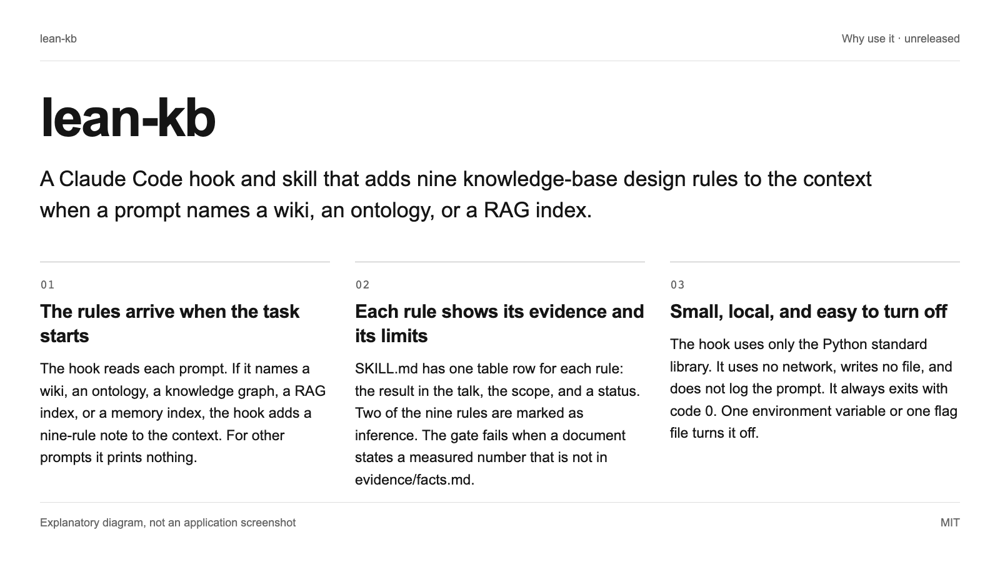
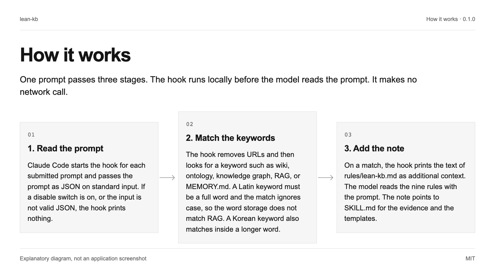
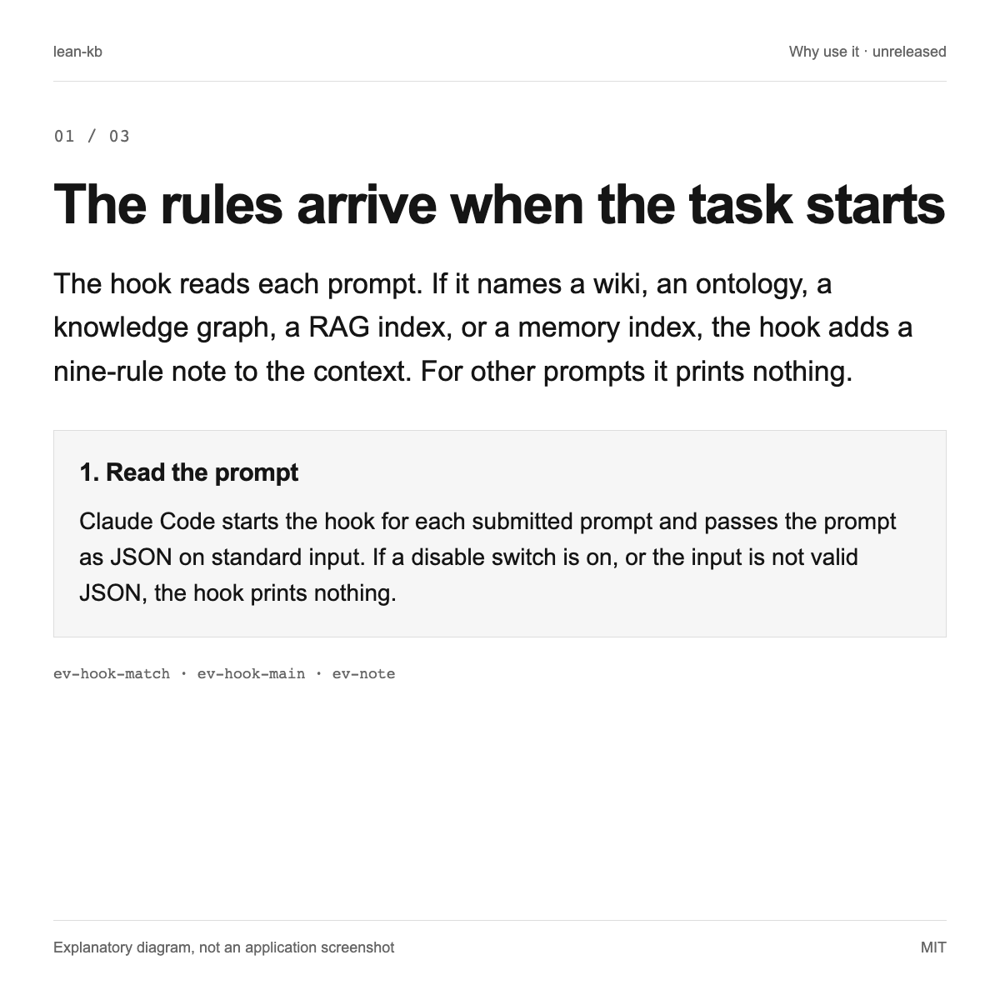
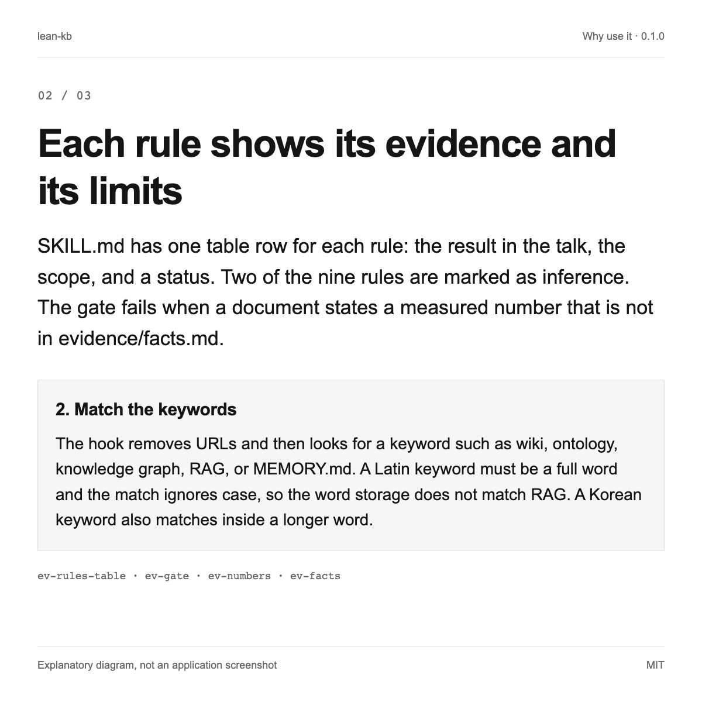
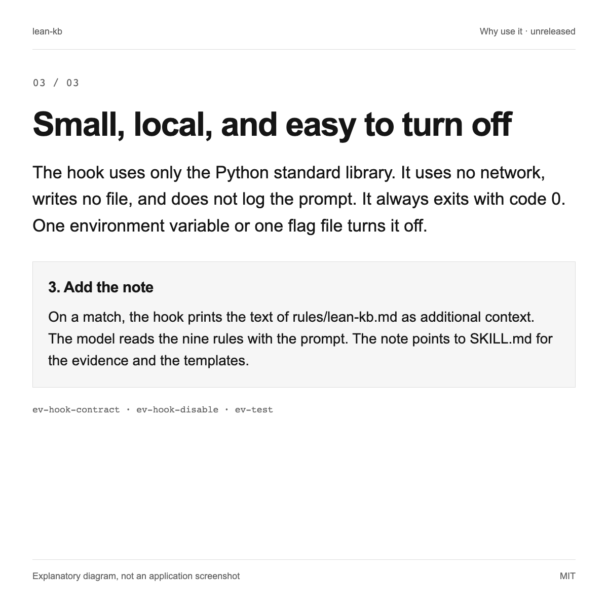

# lean-kb

A Claude Code hook and skill that adds nine knowledge-base design rules to the context when a prompt names a wiki, an ontology, or a RAG index.

**English** | [한국어](README.ko.md) | [日本語](README.ja.md) | [简体中文](README.zh.md)



0.1.0 · MIT

## Why use it

| | |
| --- | --- |
| The rules arrive when the task starts | The hook reads each prompt. If it names a wiki, an ontology, a knowledge graph, a RAG index, or a memory index, the hook adds a nine-rule note to the context. For other prompts it prints nothing. |
| Each rule shows its evidence and its limits | SKILL.md has one table row for each rule: the result in the talk, the scope, and a status. Two of the nine rules are marked as inference. The gate fails when a document states a measured number that is not in evidence/facts.md. |
| Small, local, and easy to turn off | The hook uses only the Python standard library. It uses no network, writes no file, and does not log the prompt. It always exits with code 0. One environment variable or one flag file turns it off. |

## Quick start

You need Claude Code, Python 3, bash, and git. Enter the three lines in a terminal. They clone the skill, run the hook self-test, and send one sample prompt to the hook.

```text
git clone https://github.com/grow1023/lean-kb.git ~/.claude/skills/lean-kb
bash ~/.claude/skills/lean-kb/hooks/lean_kb_hook.test.sh
printf '%s' '{"prompt":"design a wiki index"}' | python3 ~/.claude/skills/lean-kb/hooks/lean_kb_hook.py
```

The self-test prints one PASS line for each case and then ALL PASS. The third line prints a JSON object whose additionalContext starts with [lean-kb]. To turn the hook on, add this object to the hooks.UserPromptSubmit list in ~/.claude/settings.json, then start a new session: `{"hooks":[{"type":"command","command":"python3 -I \"$HOME/.claude/skills/lean-kb/hooks/lean_kb_hook.py\"","timeout":5}]}`

## How it works

One prompt passes three stages. The hook runs locally before the model reads the prompt. It makes no network call.



### 1. Read the prompt

Claude Code starts the hook for each submitted prompt and passes the prompt as JSON on standard input. If a disable switch is on, or the input is not valid JSON, the hook prints nothing.

### 2. Match the keywords

The hook removes URLs and then looks for a keyword such as wiki, ontology, knowledge graph, RAG, or MEMORY.md. A Latin keyword must be a full word and the match ignores case, so the word storage does not match RAG. A Korean keyword also matches inside a longer word.

### 3. Add the note

On a match, the hook prints the text of rules/lean-kb.md as additional context. The model reads the nine rules with the prompt. The note points to SKILL.md for the evidence and the templates.

## Use cases

### Plan the index of a team wiki

Ask for the structure of a wiki. The note tells the model to keep page bodies behind one index line for each page, to keep rules in the always-loaded part, and to state the always-loaded size.

### Clean a Claude Code memory index

Ask to tidy MEMORY.md. The rules keep each rule line above the truncation limit and move fact bodies behind index lines. SKILL.md gives a manual method to measure how much of the index a session opens.

### Change an ontology schema with a check

Ask for an ontology or knowledge-graph change. The note asks for one canonical node for each entity, dated entries for changed facts, and a check that you define before you see the result. SKILL.md marks the node rule as inference.







## Limits and privacy

- The rules come from one conference talk (NAVER D2, https://d2.naver.com/helloworld/5087915) with small samples from one environment. The talk did not test the rules on a wiki or an ontology. Check each rule in your own repository before you rely on it.

- This project is an independent summary. It is not a NAVER project, and it is not the Haema engine from the talk. It implements no retrieval, no dedupe, and no session rollover.

- The hook matches keywords only. A knowledge-base request without a keyword gets no note, and the share of such requests is not measured. The words Obsidian, memory, CLAUDE.md, and graph are not keywords, because they matched unrelated prompts more often. A prompt that starts with `!` or with a side-agent note also gets no note.

- The hook keeps no state. It adds the full note to each matching prompt, so the cost is the note size multiplied by the number of matching prompts in a session. This repeat is contrary to rule 4 of the note. Session dedupe is not implemented.

- The hook runs on prompts that the user submits. A subagent receives its prompt from the parent agent, so the note is not expected to reach a subagent. This behavior is not tested. If you delegate knowledge-base work, give the subagent the path of rules/lean-kb.md.

- The self-test and the gate ran on macOS with bash and Python 3. Linux and Windows are not tested. The gate check for writing style needs the asd-ste100 linter, which is a separate project. Without it, that check fails unless you set LEAN_KB_SKIP_STE=1.

## Verification

- **Execution verified**: The hook self-test ran and every case passed: prompts that must get the note, prompts that must get nothing, both disable switches, a missing rule file, and a check that the prompt text does not appear in the output.
- **Execution verified**: The master gate ran with exit code 0. It compiles the Python files, runs the self-test, checks the size of the rule note, runs the writing-style linter, and compares each measured number in SKILL.md and the READMEs with evidence/facts.md.
- **Execution verified**: In one Claude Code session with a temporary settings file, a wiki prompt received the note and an unrelated prompt received no note. This is one run on one machine.
- **Documented**: The numbers in SKILL.md are copied from a summary of the talk. Slide values and audio-only values are labeled. The audio-only values come from a machine transcript and can contain errors.

## Next steps

Read SKILL.md for the evidence table, the templates, and the three ratios to measure first. To turn the hook off, set LEAN_KB_DISABLE=1 or create the file ~/.claude/lean-kb.off. To remove it, delete its entry from settings.json and then delete the folder.

<details>
<summary>Source map</summary>

[JSON](docs/showcase/sources.json)

- `ev-hook-contract`: `hooks/lean_kb_hook.py`, L3–L17 (Source inspected)
- `ev-hook-match`: `hooks/lean_kb_hook.py`, L23–L63 (Source inspected)
- `ev-hook-disable`: `hooks/lean_kb_hook.py`, L66–L70 (Source inspected)
- `ev-hook-main`: `hooks/lean_kb_hook.py`, L80–L97 (Source inspected)
- `ev-note`: `rules/lean-kb.md`, L1–L13 (Documented)
- `ev-rules-table`: `SKILL.md`, L18–L34 (Documented)
- `ev-measure`: `SKILL.md`, L36–L46 (Documented)
- `ev-templates`: `SKILL.md`, L48–L67 (Documented)
- `ev-register`: `SKILL.md`, L93–L101 (Documented)
- `ev-hook-behavior`: `SKILL.md`, L103–L114 (Documented)
- `ev-live-check`: `SKILL.md`, L115–L115 (Execution verified)
- `ev-subagent`: `SKILL.md`, L117–L119 (Documented)
- `ev-limits`: `SKILL.md`, L121–L130 (Documented)
- `ev-test`: `hooks/lean_kb_hook.test.sh`, L1–L88 (Execution verified)
- `ev-gate`: `gates/verify_lean_kb.sh`, L1–L67 (Execution verified)
- `ev-numbers`: `scripts/check_numbers.py`, L2–L10 (Execution verified)
- `ev-facts`: `evidence/facts.md`, L1–L5 (Documented)

- `rules-at-task-time` → `ev-hook-match`, `ev-hook-main`, `ev-note`
- `evidence-with-limits` → `ev-rules-table`, `ev-gate`, `ev-numbers`, `ev-facts`
- `small-and-reversible` → `ev-hook-contract`, `ev-hook-disable`, `ev-test`
- `read-prompt` → `ev-hook-contract`, `ev-hook-disable`, `ev-hook-main`
- `match-keywords` → `ev-hook-match`, `ev-test`
- `add-note` → `ev-hook-main`, `ev-note`, `ev-rules-table`
- `team-wiki` → `ev-note`, `ev-templates`
- `memory-index` → `ev-note`, `ev-measure`, `ev-limits`
- `schema-change` → `ev-note`, `ev-rules-table`, `ev-templates`
- `one-talk` → `ev-limits`, `ev-facts`
- `not-affiliated` → `ev-limits`, `ev-facts`
- `keyword-trigger` → `ev-hook-behavior`
- `stateless-cost` → `ev-hook-behavior`, `ev-hook-contract`
- `subagents` → `ev-subagent`
- `platform` → `ev-gate`, `ev-limits`
- `v-selftest` → `ev-test`
- `v-gate` → `ev-gate`, `ev-numbers`
- `v-live` → `ev-live-check`
- `v-talk-numbers` → `ev-facts`, `ev-rules-table`
- `quickstart` → `ev-register`, `ev-test`, `ev-hook-main`

</details>
