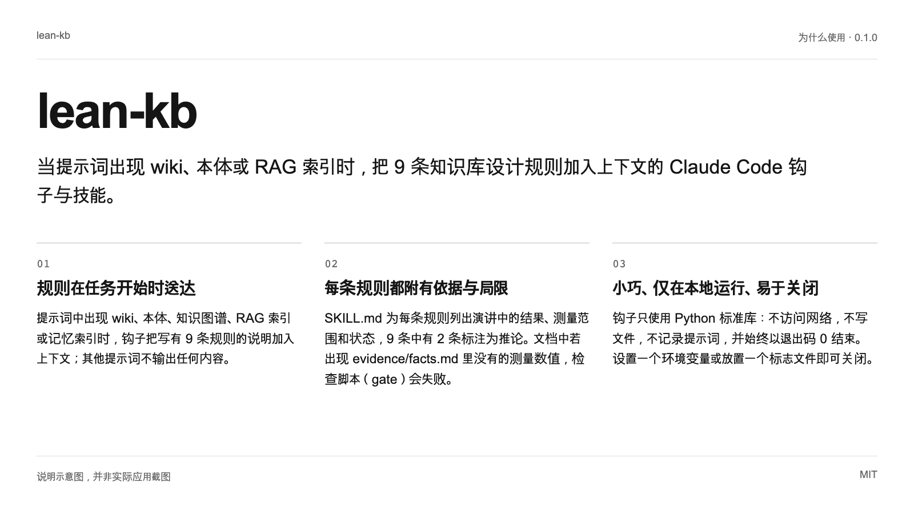
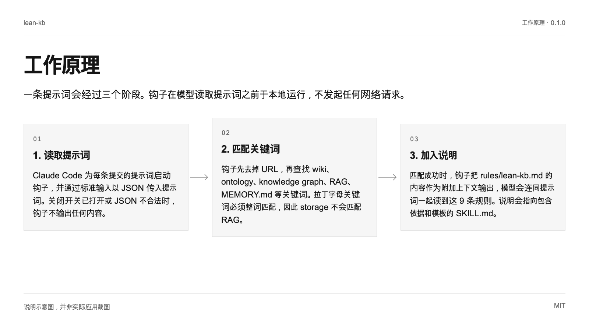
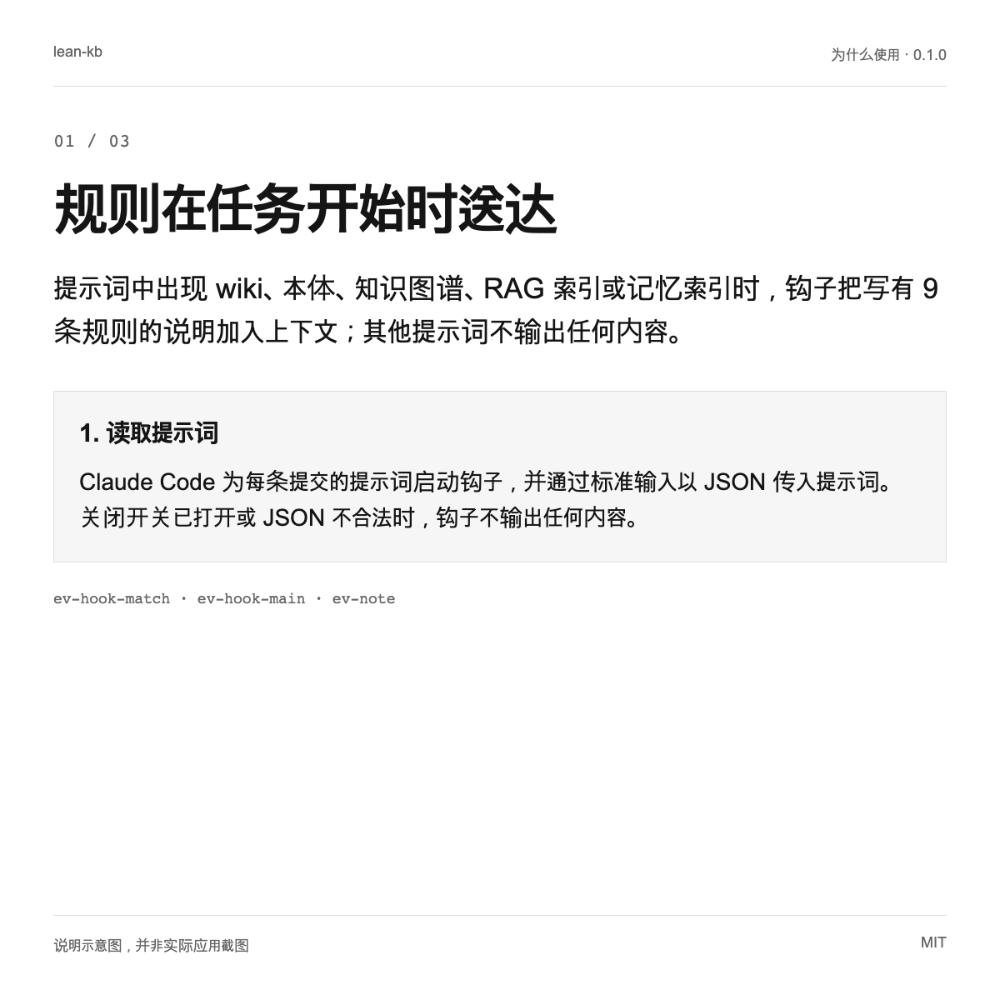
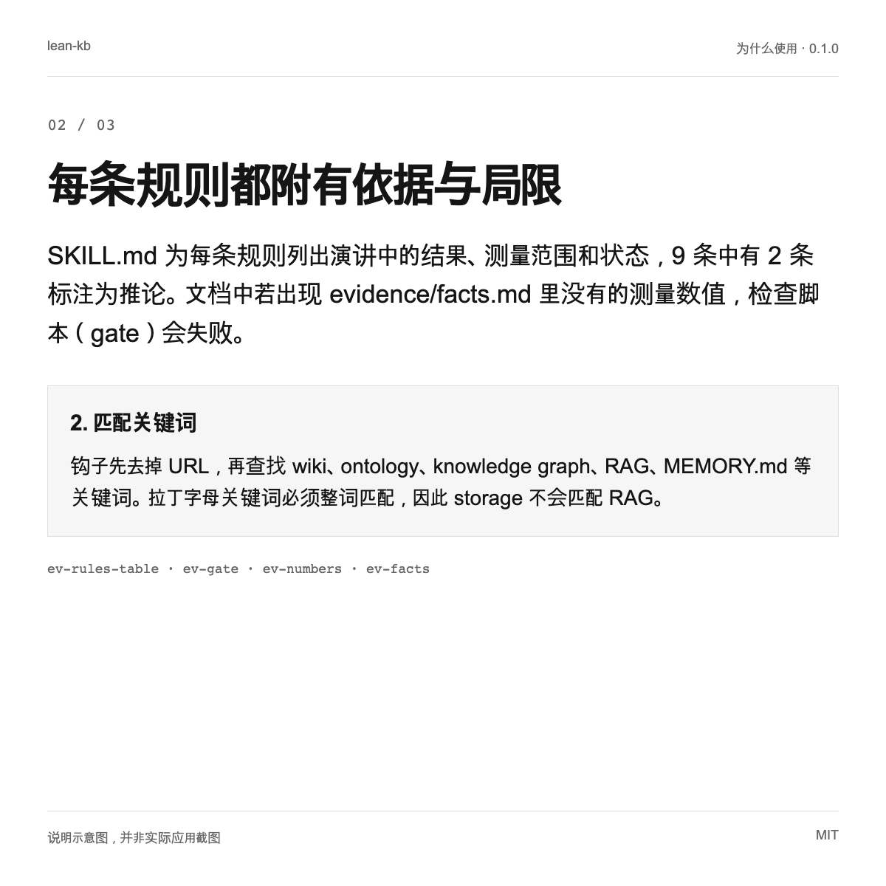
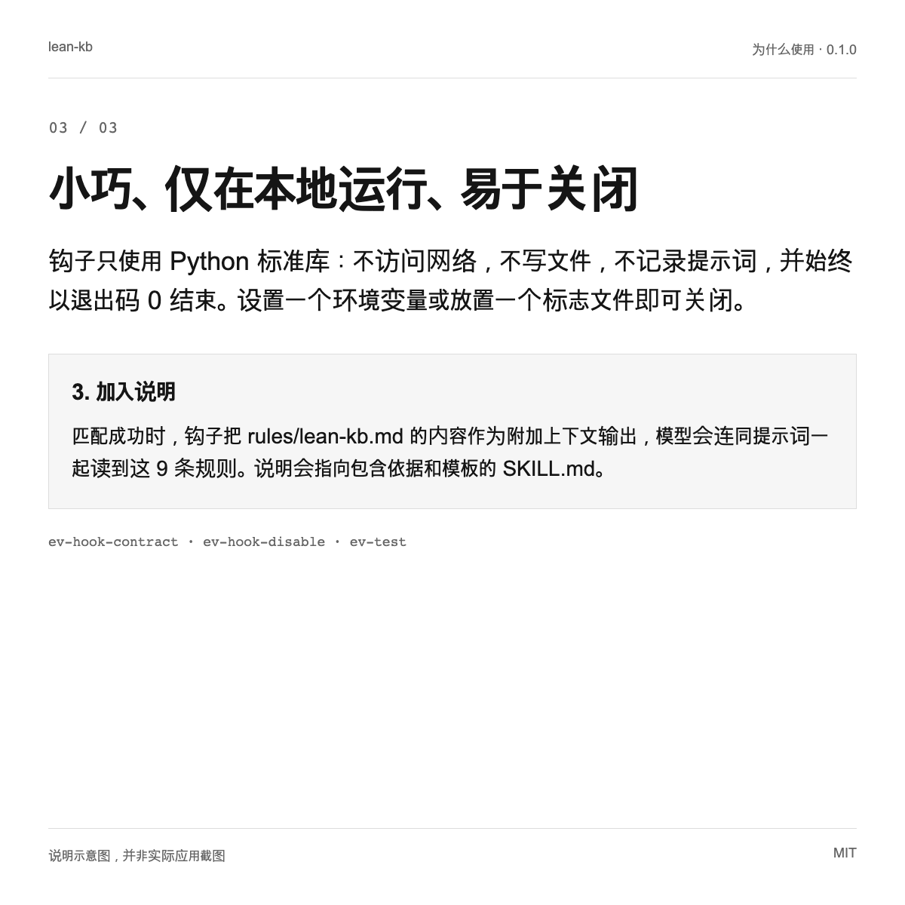

# lean-kb

当提示词出现 wiki、本体或 RAG 索引时，把 9 条知识库设计规则加入上下文的 Claude Code 钩子与技能。

[English](README.md) | [한국어](README.ko.md) | [日本語](README.ja.md) | **简体中文**



0.1.0 · MIT

## 为什么使用

| | |
| --- | --- |
| 规则在任务开始时送达 | 提示词中出现 wiki、本体、知识图谱、RAG 索引或记忆索引时，钩子把写有 9 条规则的说明加入上下文；其他提示词不输出任何内容。 |
| 每条规则都附有依据与局限 | SKILL.md 为每条规则列出演讲中的结果、测量范围和状态，9 条中有 2 条标注为推论。文档中若出现 evidence/facts.md 里没有的测量数值，检查脚本（gate）会失败。 |
| 小巧、仅在本地运行、易于关闭 | 钩子只使用 Python 标准库：不访问网络，不写文件，不记录提示词，并始终以退出码 0 结束。设置一个环境变量或放置一个标志文件即可关闭。 |

## 快速开始

需要 Claude Code、Python 3、bash 和 git。在终端中依次输入下面三行：克隆技能、运行钩子自测、向钩子发送一条示例提示词。

```text
git clone https://github.com/grow1023/lean-kb.git ~/.claude/skills/lean-kb
bash ~/.claude/skills/lean-kb/hooks/lean_kb_hook.test.sh
printf '%s' '{"prompt":"design a wiki index"}' | python3 ~/.claude/skills/lean-kb/hooks/lean_kb_hook.py
```

自测会为每个用例输出一行 PASS，最后输出 ALL PASS。第三行会输出一个 JSON 对象，其 additionalContext 以 [lean-kb] 开头。要启用钩子，请把下面的对象加入 ~/.claude/settings.json 的 hooks.UserPromptSubmit 列表，然后开启新会话：`{"hooks":[{"type":"command","command":"python3 -I \"$HOME/.claude/skills/lean-kb/hooks/lean_kb_hook.py\"","timeout":5}]}`

## 工作原理

一条提示词会经过三个阶段。钩子在模型读取提示词之前于本地运行，不发起任何网络请求。



### 1. 读取提示词

Claude Code 为每条提交的提示词启动钩子，并通过标准输入以 JSON 传入提示词。关闭开关已打开或 JSON 不合法时，钩子不输出任何内容。

### 2. 匹配关键词

钩子先去掉 URL，再查找 wiki、ontology、knowledge graph、RAG、MEMORY.md 等关键词。拉丁字母关键词必须整词匹配，因此 storage 不会匹配 RAG。

### 3. 加入说明

匹配成功时，钩子把 rules/lean-kb.md 的内容作为附加上下文输出，模型会连同提示词一起读到这 9 条规则。说明会指向包含依据和模板的 SKILL.md。

## 使用场景

### 规划团队 wiki 的索引

当你请求设计 wiki 结构时，说明会告诉模型：页面正文放在每页一行的索引之后，规则放在始终加载的部分，并说明始终加载内容的大小。

### 整理 Claude Code 的记忆索引

当你请求整理 MEMORY.md 时，规则要求把规则行放在截断上限之上，把事实正文移到索引行之后。SKILL.md 提供了一种手动方法，用来测量一次会话实际打开了索引的多大比例。

### 先定检查标准，再修改本体模式

当你请求修改本体或知识图谱时，说明会要求：每个实体只有一个规范节点，变更的事实写成带日期的条目，并在看到结果之前先定义检查方法。规范节点这条规则在 SKILL.md 中标注为推论。







## 限制与隐私

- 这些规则的依据是一场会议演讲（NAVER D2，https://d2.naver.com/helloworld/5087915），样本较小，且来自单一环境。演讲并未在 wiki 或本体上验证这些规则。在依赖某条规则之前，请先在自己的仓库中验证。

- 本项目是独立整理的摘要，不是 NAVER 的项目，也不是演讲中的 Haema 引擎。它不实现检索、去重和会话切分（rollover）。

- 钩子只匹配关键词。不含关键词的知识库请求不会收到说明，这类请求所占的比例尚未测量。Obsidian、memory、CLAUDE.md、graph 更常匹配到无关的提示词，因此没有列为关键词。

- 钩子不保存状态。每条匹配的提示词都会加入完整的说明，因此成本等于说明的大小乘以一次会话中匹配的提示词数量。

- 钩子在用户提交提示词时运行。子代理的提示词来自父代理，因此说明预计不会传递给子代理；这一行为尚未测试。如果把知识库工作委派出去，请把 rules/lean-kb.md 的路径交给子代理。

- 自测和检查脚本（gate）在 macOS 上使用 bash 和 Python 3 运行过，尚未在 Linux 和 Windows 上测试。gate 中的文体检查依赖另一个独立项目 asd-ste100 的 linter；没有它时，除非设置 LEAN_KB_SKIP_STE=1，否则该项检查会失败。

## 验证状态

- **已验证运行**: 已运行钩子自测，所有用例均通过：应收到说明的提示词、不应有任何输出的提示词、两种关闭开关、规则文件缺失的情况，以及确认提示词内容不会出现在输出中的检查。
- **已验证运行**: 主检查脚本（master gate）以退出码 0 结束。它会编译 Python 文件、运行自测、检查规则说明的大小、运行文体 linter，并将 SKILL.md 与各 README 中的测量数值同 evidence/facts.md 逐一比对。
- **已验证运行**: 在一次使用临时设置文件的 Claude Code 会话中，wiki 提示词收到了说明，无关的提示词没有收到。这只是在一台机器上的一次运行结果。
- **文档说明**: SKILL.md 中的数值抄自对该演讲的摘要文件。从幻灯片读取的数值与仅凭音频确认的数值分别作了标注。仅凭音频确认的数值来自机器转写，可能有误。

## 下一步

依据表、模板以及应当首先测量的三个比例都在 SKILL.md 中。要关闭钩子，请设置 LEAN_KB_DISABLE=1，或创建文件 ~/.claude/lean-kb.off。要卸载，请先从 settings.json 中删除对应条目，再删除该文件夹。

<details>
<summary>依据列表</summary>

[JSON](docs/showcase/sources.json)

- `ev-hook-contract`: `hooks/lean_kb_hook.py`, L3–L17 (已检查代码)
- `ev-hook-match`: `hooks/lean_kb_hook.py`, L23–L59 (已检查代码)
- `ev-hook-disable`: `hooks/lean_kb_hook.py`, L62–L66 (已检查代码)
- `ev-hook-main`: `hooks/lean_kb_hook.py`, L76–L93 (已检查代码)
- `ev-note`: `rules/lean-kb.md`, L1–L13 (文档说明)
- `ev-rules-table`: `SKILL.md`, L18–L34 (文档说明)
- `ev-measure`: `SKILL.md`, L36–L46 (文档说明)
- `ev-templates`: `SKILL.md`, L48–L91 (文档说明)
- `ev-register`: `SKILL.md`, L93–L101 (文档说明)
- `ev-hook-behavior`: `SKILL.md`, L103–L111 (文档说明)
- `ev-live-check`: `SKILL.md`, L112–L112 (已验证运行)
- `ev-subagent`: `SKILL.md`, L114–L116 (文档说明)
- `ev-limits`: `SKILL.md`, L118–L126 (文档说明)
- `ev-test`: `hooks/lean_kb_hook.test.sh`, L1–L74 (已验证运行)
- `ev-gate`: `gates/verify_lean_kb.sh`, L1–L67 (已验证运行)
- `ev-numbers`: `scripts/check_numbers.py`, L2–L10 (已验证运行)
- `ev-facts`: `evidence/facts.md`, L1–L5 (文档说明)

- `rules-at-task-time` → `ev-hook-match`, `ev-hook-main`, `ev-note`
- `evidence-with-limits` → `ev-rules-table`, `ev-gate`, `ev-numbers`, `ev-facts`
- `small-and-reversible` → `ev-hook-contract`, `ev-hook-disable`, `ev-test`
- `read-prompt` → `ev-hook-contract`, `ev-hook-disable`, `ev-hook-main`
- `match-keywords` → `ev-hook-match`, `ev-test`
- `add-note` → `ev-hook-main`, `ev-note`, `ev-rules-table`
- `team-wiki` → `ev-note`, `ev-templates`
- `memory-index` → `ev-note`, `ev-measure`, `ev-limits`
- `schema-change` → `ev-note`, `ev-rules-table`, `ev-templates`
- `one-talk` → `ev-limits`, `ev-facts`
- `not-affiliated` → `ev-limits`, `ev-facts`
- `keyword-trigger` → `ev-hook-behavior`
- `stateless-cost` → `ev-hook-behavior`, `ev-hook-contract`
- `subagents` → `ev-subagent`
- `platform` → `ev-gate`, `ev-limits`
- `v-selftest` → `ev-test`
- `v-gate` → `ev-gate`, `ev-numbers`
- `v-live` → `ev-live-check`
- `v-talk-numbers` → `ev-facts`, `ev-rules-table`
- `quickstart` → `ev-register`, `ev-test`, `ev-hook-main`

</details>
